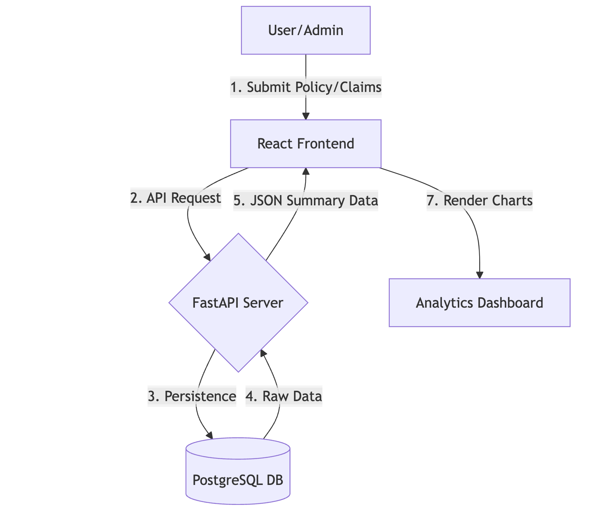
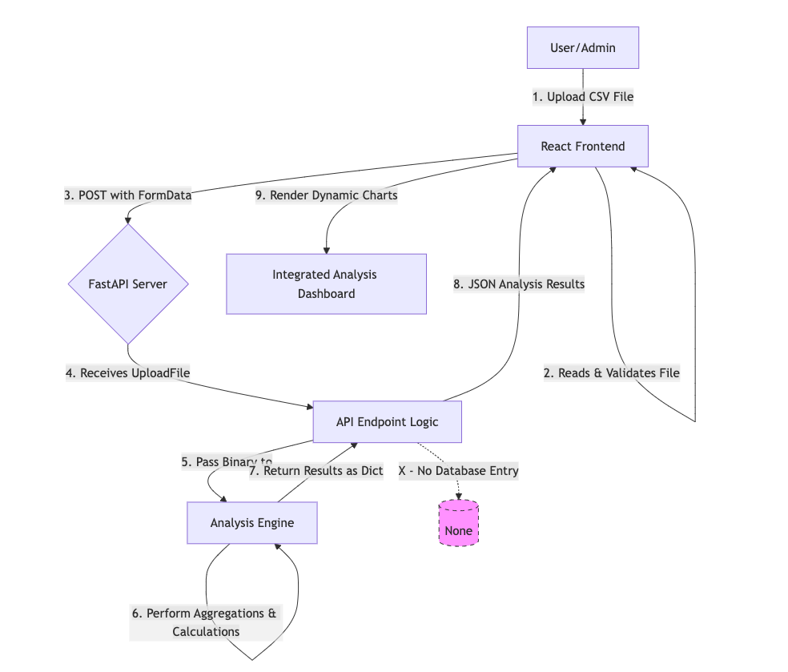
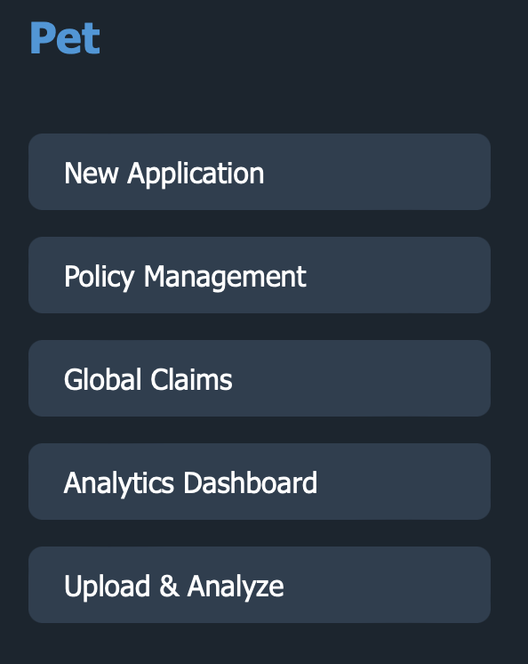
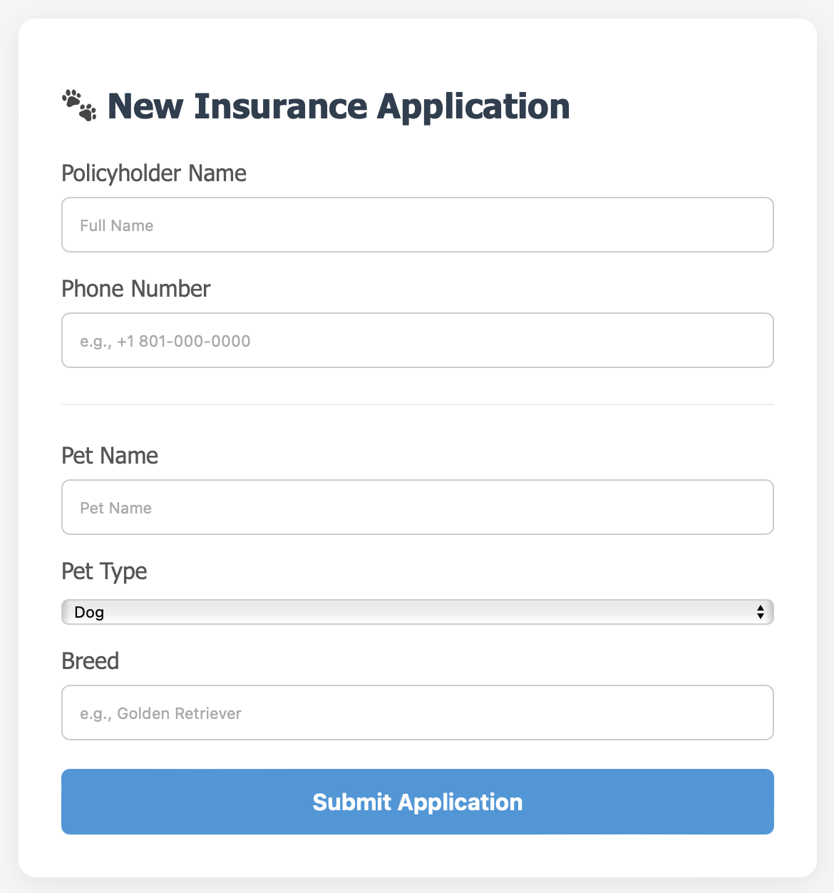
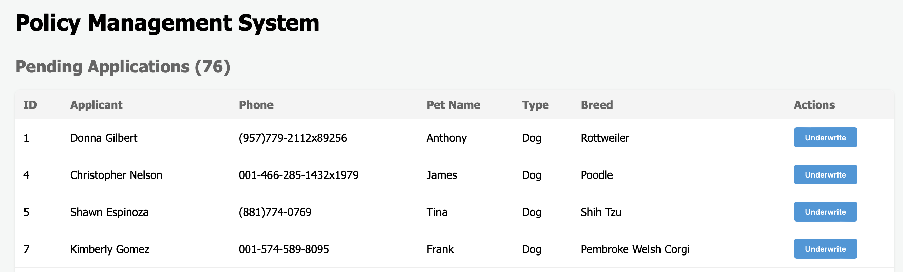
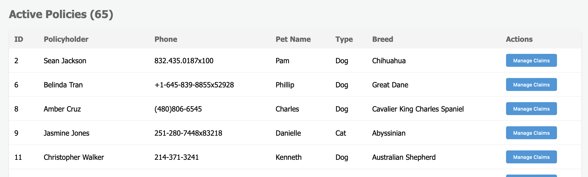
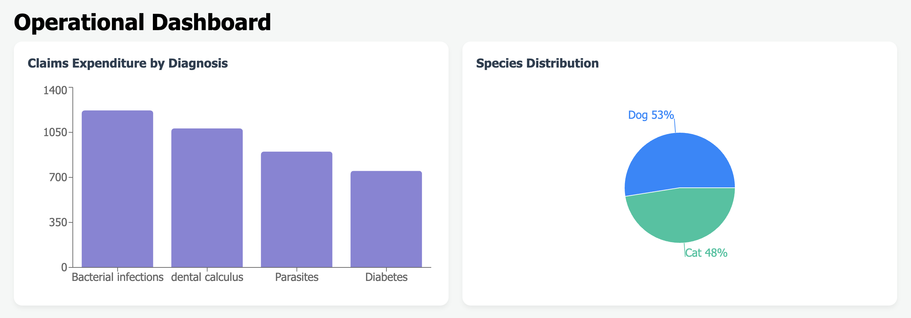

**Pet Insurance Claims & Risk Analytics Data Tool Report**

---

### Report Overview
**1. Introduction**
* 1.1 Data Flow Diagram
* 1.2 Data Flow of the Integrated Analysis Module(Upload & Analyze)
    

**2. System Architecture**
* 2.1 Frontend Navigation
* 2.2 Enrollment Interface (RegisterPage)
* 2.3 Underwriting Workflow
* 2.4 Operational Dashboard
* 2.5 Backend Implementation: FastAPI & PostgreSQL
* 2.6 Database Schema & Data Modeling
    * 2.6.1 Data Field Design Logic

---

## 1. Introduction
This project focuses on building a centralized Pet Insurance Administration and Analytics Portal. By integrating frontend data entry with a backend relational database, the tool provides a reliable tracking mechanism for policy applications and claims, effectively eliminating the risk of "missing cases" common in manual workflows.

Additionally, the portal features an integrated analysis module that allows users to upload existing CSV files to generate a comprehensive overview of their data. This component operates independently of the central database, ensuring that data is processed solely for ad-hoc analysis without persistent storage.

### 1.1 Data Flow Diagram
The following diagram illustrates how an insurance application moves from the user interface through the validation layer and into the production database:

    

* **Data Submission**: Users submit policy or claim applications via the React frontend. The frontend performs initial validation to ensure data format compliance before transforming the input into an HTTP request.

* **API Request Transmission**: The frontend encapsulates the data and transmits it to the FastAPI backend via RESTful APIs. This architecture separates UI presentation from business logic to reduce system coupling.

* **Data Persistence**: Upon receiving the request, the backend performs server-side validation and commits the record to the PostgreSQL database. This ensures all administrative records are securely stored.

* **Raw Data Retrieval**: For dashboard updates or report generation, the backend queries the database to fetch the necessary raw datasets.

* **Data Serialization**: The backend processes and aggregates the retrieved raw data, converting it into a structured JSON format for transmission.

* **Frontend Rendering**: Upon receiving the JSON data, the React frontend updates the application state to reflect the latest information.

* **Dashboard Visualization**: The frontend renders the data onto the "Analytics Dashboard" using charting libraries, providing administrators with intuitive business insights.

### 1.2 Data Flow of the Integrated Analysis Module(Upload & Analyze)

The Integrated Analysis Module within this system adopts a stateless and ephemeral architecture, operating independently from the primary database-backed workflow. The operational flow is as follows:

    

* **User Submission**: The user initiates the analysis by uploading a CSV file through the web interface.

* **Frontend Validation**: The React frontend performs initial validation, such as verifying the file format, before encapsulating the data within a POST request.

* **Backend Reception**: The FastAPI backend receives the file stream directly into memory. Crucially, the system does not write the file to persistent storage.

* **Real-time Analysis**: The backend invokes the Pandas data analysis engine, which processes the binary stream in-memory. This allows for real-time computations, such as data aggregation and risk model simulations.

* **Data Response**: Upon completion of the analysis, the processed results are converted into a JSON format and returned to the frontend.

* **Dynamic Visualization**: The React frontend dynamically renders the received JSON data into interactive charts and tables.

---

## 2. System Architecture

This tool is built as a modular application designed for scalability and data-driven decision making.

### 2.1 Frontend Navigation

* **New Application**: A data-entry portal for policy enrollment.
* **Policy Management**: An administrative interface for underwriting and claims linkage.
* **Global Claims**: A high-level ledger for all processed insurance claims.
* **Analytics Dashboard**: Real-time business intelligence powered by PostgreSQL.
* **Actuarial Sandbox**: A specialized tool for batch-processing CSV data and calculating loss ratios.

    

---

### 2.2 Enrollment Interface (RegisterPage)
- **Data Capture**: Designed a streamlined application form for capturing primary policyholder details.

    

---

### 2.3 Underwriting Workflow
- **Application Review**: Developed a "Pending Applications" queue to allow users to review and "Underwrite" new enrollments.
- **Claims Linkage**: Once a policy is active, it is transitioned to the "Active Policies" fleet, where users can manage specific claims and link them to existing policy IDs.

    

    

---

### 2.4 Operational Dashboard
- **Real-time Monitoring**: Established a live connection to PostgreSQL for instant loss ratio tracking.

    

---

### 2.5 Backend Implementation: FastAPI & PostgreSQL

The backend is built using **FastAPI** and **PostgreSQL**.

#### 2.5.1 RESTful API Architecture
The server exposes several key endpoints to handle the Create, Read, Update, and Delete operations for the insurance system:

| Endpoint | Method | Description |
| :--- | :--- | :--- |
| `/api/cases` | `GET` | Retrieves all policy applications. |
| `/api/cases` | `POST` | Creates a new policy enrollment record. |
| `/api/cases/{case_id}/approve` | `PATCH` | Transitions a policy status from 'new' to 'approved'. |
| `/api/claims` | `POST` | Submits a new claim and links it to a Policy ID. |
| `/api/cases/{case_id}/claims}` | `GET` | Retrieves all claims associated with a specific policy ID. |
| `api/all_claims/` | `GET` | Retrieves all claims across the entire system. |
| `/api/analytics/summary` | `GET` | Performs SQL aggregations for the Live Dashboard. 
| `/api/analyze-data` | `POST` | Executes complex risk modeling or predictive analytics logic. |
| `/api/upload-pet` | `POST`| Handles pet-related file uploads. |
| `/api/upload-claim` | `POST`| Handles claim-related file uploads. |

### 2.6 Database Schema & Data Modeling
#### 2.6.1 Data Field Design Logic
The insurance_cases schema balances administrative workflow requirements with analytical reporting needs. Key field categories are defined as follows:

* **Identifiers**: id (Primary Key): Unique case identifier. Serves as the single source of truth and anchors one-to-many relationships with claims, ensuring referential integrity.

* **Client Info**: policyholder_name, policyholder_phone: CRM foundations enabling efficient record retrieval, client communication, and lifecycle accountability.

* **Risk Attributes**: insured_pet_type, insured_pet_breed: Core variables for risk assessment. Decoupling these enables the construction of granular risk matrices and financial exposure analysis across pet demographics.

* **Lifecycle State**: status: Functions as an operational state machine. It drives UI workflow logic and tracks policy conversion performance.

